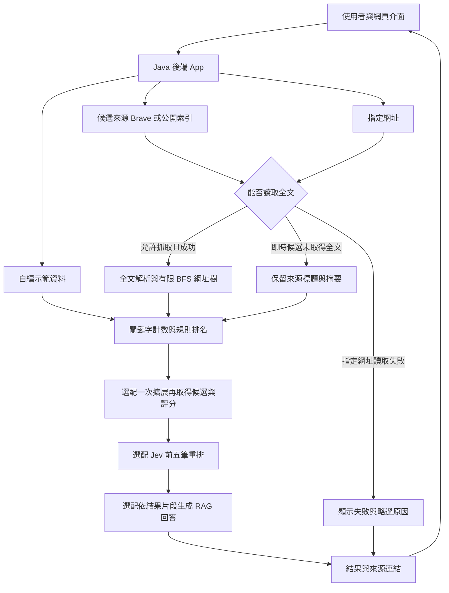

# AI WEBSITE 專案功能與架構說明書

更新日期：2026 年 10 月 8 日

AI WEBSITE 是資料結構期末專題的 AI 議題搜尋網站。使用者輸入問題，系統取得候選網頁，再根據關鍵字、取得的內容及搜尋目的重新排名，提供可開啟的來源連結。

目前已有可操作的本機網站，涵蓋搜尋、關鍵字計數、網址樹與評估工具。**已做出功能，不等於已證明比 Google 好，也不等於所有課程階段都已完成。** 公開部署及正式比較實驗仍是後續工作。

## 一 專案定位與目前狀態

搜尋範圍包含 AI 技術、地緣政治、哲學、經濟、政策與社會議題，不限於 LLM、RAG 或 Agent。例如可以查詢 `RSI`、`AI 地緣政治`、`AI 意識 哲學`、`AI 經濟 就業`。未知詞仍會送入查詢，不必先列在我們的詞彙表中；有沒有適合的結果，仍取決於來源的收錄範圍與查詢內容。

使用者可選擇三種目的：

| 搜尋目的 | 想找到的內容 |
|---|---|
| 概念與背景 | 定義、基本說明、背景與脈絡 |
| 觀點與比較 | 不同觀點、方法差異、適用情境與限制 |
| 研究與應用 | 實證研究、政策或實務應用，以及需要時的技術步驟 |

本機目前的連線與功能狀態如下。組員在另一台電腦執行時，須依自己的設定啟用服務。

| 項目 | 目前狀態 |
|---|---|
| 網頁介面 | 已完成簡潔的白底列表介面，支援桌面與手機 |
| Brave 搜尋 | 已設定金鑰，完成一次真實搜尋連線驗證 |
| Wikipedia 與 Crossref | 免金鑰公開索引已串接，已有真實查詢紀錄 |
| 關鍵字計數與規則排名 | 已實作並有自動測試 |
| Jev 重排 | 串接程式與模擬測試已完成，目前未啟用、未做真實模型實測 |
| RAG 來源回答 | 串接程式與模擬測試已完成，目前未啟用、未做真實模型實測 |
| Google 與 LLM 成效比較 | 題庫、提示詞及評分工具已建立，正式實驗尚未完成 |
| 對外發布 | 尚未完成；目前是本機網站 |

目前的產品是「取得候選來源後分析與重排」的搜尋網站。**尚未建立自己的持久網頁資料庫或倒排索引，也沒有自行收錄整個網路。**

## 二 Stage 完成狀態與準備事項

以下依 `Lec3.pdf` 第 4 至 7 頁整理。「部分完成」表示已有可展示的程式，但仍有功能範圍、實測或交付事項未完成；最終是否符合課程要求，以老師與助教判定為準。

| Stage 與老師要求 | 已建立的功能 | 目前狀態 | 還需要準備或完成的事項 |
|---|---|---|---|
| **Stage 0 關鍵字計數**：給網址與關鍵字，回傳次數 | 關鍵字實驗頁、公開頁面讀取、Boyer–Moore 比對與次數顯示 | **功能已完成** | 選一個可抓取的真實頁面，人工核對次數；確認大小寫、重疊命中及英文詞邊界是否符合老師期待 |
| **Stage 1 網頁排名**：給多個網址與關鍵字，顯示排名、分數及各詞次數 | 指定網址模式、計數、計分與排序，結果明細可查分數 | **功能已完成** | 準備數個可抓取的頁面，以深度 0 展示單頁排名；能手算並解釋一筆分數，且清楚區分全文與摘要 |
| **Stage 2 網站排名**：連同子網址分析，顯示樹及各節點次數 | BFS 走訪、網址去重、節點計數、分層彙總與樹狀展示 | **部分完成**：有界限的網站樹已完成 | 講義要求包含所有子網址，目前程式有深度、頁數及來源限制；須向助教確認可接受範圍，並準備真實多層網站的完整展示 |
| **Stage 3 取得搜尋候選再重排**：只輸入關鍵字，以搜尋引擎找網址並套用 Stage 2 | Brave 候選搜尋、公開索引備援與自訂排名；Brave 已小量實測成功 | **部分完成**：候選取得與重排已可用 | 許多候選目前只有搜尋摘要，尚非全部套用完整網站分析；須準備可抓取全文及子頁的案例、保存原始與重排結果，並確認 Brave 候選符合老師對此階段的要求 |
| **Stage 4 語意分析與迭代**：從找到的網站衍生相關詞，再搜尋 | 從已取得的內容挑出最多 3 個相關詞，最多再搜尋 1 輪 | **部分完成**：基本關鍵字擴展已完成 | 目前是固定詞表與字詞命中規則，不是語意模型；需展示新詞來自哪些內容、是否產生新結果，並比較擴展前後的相關性與耗時 |
| **Stage 5 發布網站或 App** | 本機網頁、後端服務、Dockerfile 與部署說明已提供 | **尚未完成公開部署** | 選擇主機、設定 HTTPS 與存取控制、保管金鑰及限制費用；讓其他電腦實際連線測試。Docker 尚未在目標環境驗證 |
| **Stage 6 與 LLM 比較**：把搜尋技巧寫成提示詞，蒐集並比較輸出 | 50 題題庫、一般與策略提示詞匯出、人工評分、CSV 與指標計算 | **尚未完成正式實驗** | 固定題庫及設定，蒐集真實 Google／LLM 結果，記錄模型與日期，由至少兩人判讀，完成比較表、圖表與結論；工具存在不代表已有實驗成績 |

**優先處理 Stage 2、3 的完整網站分析證據，再完成 Stage 5 的部署與 Stage 6 的實驗。** Jev 和 RAG 是選配加強功能，不是上述階段全部完成的前提，也不能代替課程要求的網址樹與比較實驗。

## 三 使用者可以操作的功能

### 知識搜尋

輸入關鍵字、選擇搜尋目的後送出查詢。結果顯示標題、來源、內容片段，以及「已取得全文」「搜尋摘要」或「示範內容」等狀態；點標題或「開啟原文」可閱讀真實來源。

計分、原始名次、關鍵字次數及網址樹預設收合，使用者需要時再展開。搜尋結果可以匯出 JSON 或 CSV，保存當次設定、排名與來源資料。

| 模式 | 功能與資料來源 |
|---|---|
| 即時公開來源搜尋 | 本機目前優先用 Brave 找候選；沒有 Brave 金鑰或 Brave 呼叫失敗時，使用 Wikipedia 與 Crossref API |
| 自行提供公開網址 | 使用者提供最多 10 個網址，分析允許抓取的頁面與有限子頁；不需要搜尋 API，但需自行知道候選網址 |
| 自編示範資料 | 使用 22 篇自編資料展示算法與介面；`demo.local` 不是外部網站，不能當成真實搜尋結果 |

Brave 正常回傳空結果時，目前不會自動切換來源。所有即時來源都可能遇到無結果或限流，介面會提供狀態與外部搜尋連結，不會拿示範資料冒充真實結果。

### 關鍵字實驗

選擇示範頁或輸入允許抓取的真實網址，再輸入如 `RAG, Python` 的關鍵字清單。此功能計算原詞在取得文字中的次數，不自動加入同義詞。

英文不分大小寫，並檢查英文字詞邊界，例如 `RAG` 不會命中 `paragraph`。中文採字串比對，允許重疊命中。實驗頁計正文；搜尋排名則會計算標題加上正文或來源摘要，兩者的次數可能不同。

### 評估工作台

提供 20 題開發用與 30 題保留測試用題目，預設只顯示開發題。組員可填寫各系統前五筆是否相關及完成任務時間，下載或匯入評分 CSV，再計算：

- **Precision@5**：前五筆有幾筆相關。例如 4 筆相關，分數為 80%。
- **MRR@5**：第一筆相關結果的排名倒數，再對題目取平均。第一筆相關在第 2 名，該題就是 1/2。
- **平均完成時間**：只計入有填寫人工完成秒數的題目；不是程式自身的等待時間。

評分資料暫存在瀏覽器分頁，重新整理前要下載。資料不足題另依判讀準則檢查，不能只用排名指標評估是否誤導。各系統應使用同一批題目及條件，才能比較平均分數。

## 四 技術框架與系統架構

| 層級 | 使用技術 | 負責工作 |
|---|---|---|
| 前端 | 原生 HTML、CSS、JavaScript | 搜尋表單、結果與原文連結、網址樹、評分及下載 |
| 後端 | Java 21，JDK 內建 HttpServer | 接收前端請求、驗證資料、控制時間與處理流程 |
| 網路與內容解析 | JDK HttpClient、HTML ParserDelegator | 呼叫外部來源、讀取允許的 HTML、抽出文字與連結 |
| 搜尋核心 | 自行實作的 Java 類別 | 關鍵字分析、BFS、去重、計數、排名與擴展 |
| 資料儲存 | JSON 檔案及程式記憶體 | 示範語料、題庫與當次搜尋快取；目前沒有資料庫 |
| 建置與測試 | javac、PowerShell／Shell 腳本、Java 測試程式 | 編譯、啟動、驗證與打包；瀏覽器驗證另用 Playwright |

執行網站不需要 Spring Boot、React、Vue、Maven、Gradle 或 npm。瀏覽器測試用的 Node／Playwright 是開發工具，不是網站執行的必要套件。



一般使用流程是「取得候選 → 分析可取得內容 → 自訂排名 → 顯示來源」。目前 Jev 與 RAG 未啟用，使用者得到的是規則排名與原始內容片段。

### 外部 API 與自己的程式如何分工

Brave 負責提供候選網址、標題及摘要；我們自己決定如何分析、計分、重排與展示。Wikipedia／Crossref 也是外部 API，只是不需要金鑰。它們的資料範圍是百科與學術書目，不能稱作完整全網搜尋。

目前沒有實作 Google 結果頁擷取或瀏覽器自動搜尋，也沒有排程爬蟲、持久倒排索引或向量資料庫。Google 連結是供組員手動比較，不是程式已取得的 Google 原始排名。

專案本身也有內部 API，供前端呼叫 Java 後端；這和外部搜尋公司的 API 是不同層次：

| 內部端點 | 用途 |
|---|---|
| `GET /api/status` | 查詢可用功能、來源與上限，不傳回金鑰 |
| `POST /api/search` | 執行搜尋、重排與選配的模型功能 |
| `POST /api/count` | 執行關鍵字計數 |
| `GET /api/evaluation` | 取得評估題庫 |
| `POST /api/evaluate` | 根據人工填寫的紀錄計算指標 |
| `GET /api/health` | 檢查網站服務是否正在運作 |

## 五 摘要與全文的差別

**找到網址，不代表程式已讀取該網頁全文。**

搜尋結果的網域不受技術網站清單限制；但全文抓取仍受到 `FETCH_ALLOWED_HOSTS` 的精確網域清單及網站規則限制。即時候選若未取得全文，仍會保留標題、來源摘要及原文網址。

| 畫面狀態 | 實際取得的資料 | 可以解讀的內容 |
|---|---|---|
| 已取得網頁內容 | 抓取並清理後的 HTML 文字 | 該次取得文字的計數；有子頁時可展示有限走訪樹 |
| 僅搜尋摘要 | Brave 摘要、Wikipedia 導言，或 Crossref 書目 | 只代表標題與摘要／書目中的字詞，不是全文計數或整站分析 |
| 自編示範 | 專案中的教學資料 | 用來驗證程式，不能當成外部網頁或實驗成績 |

Crossref 目前只提供標題、出版來源、年份等書目，沒有讀取論文全文。搜尋紀錄中的 `pagesFetched` 在即時模式下只計成功讀取的全文頁面；`pagesProcessed` 則可能包含摘要資料。

若原始候選因字詞不同未進入規則排名，系統可能用來源摘要補足剩餘結果，分數顯示 0 並標示來源狀態。這代表保留可供閱讀的候選，不能解讀為已證明內容無關。

## 六 排名方法與資料結構

### 計分方式

設某個詞出現 `f` 次，取得的文字總長度為 `L`。目前每頁的規則分數是：

```text
單頁分數 = 所有有命中的關鍵字之 (1 + ln(f)) 加總
           ÷ sqrt(1 + L / 1200)
```

詞出現越多會加分，但增加幅度逐漸降低；文字長度也用於調整，避免長文章只因字數多就占優勢。這是專題自訂規則，**不是 BM25，也不是目前已證明最佳的公式**。

網站分數把不同深度的成功頁面整合：

```text
網站規則分數 = 根頁分數
             + 0.5 × 第一層平均分數
             + 0.25 × 第二層平均分數

基本總分 = 網站規則分數 + 0.75 × 網站需求分數
```

例如根頁為 8 分、兩層平均各為 6 分與 4 分，網站規則分數是 `8 + 0.5 × 6 + 0.25 × 4 = 12`。

需求分數來自預設訊號詞，例如概念、定義、比較、實證與政策建議，每頁最多 3 分，再按層級整合。沒有命中主題的頁面，不會只因出現需求詞就得到這項加分。失敗或略過的節點不當成 0 分頁納入平均，而是另列警告。

### 用到的資料結構

| 結構或算法 | 在專題中的作用 |
|---|---|
| Boyer–Moore | 從後向前比對字串，利用位移減少部分不必要的比較 |
| Queue／ArrayDeque | 以 BFS 逐層處理待走訪網址 |
| TreeNode 與子節點串列 | 保存父子關係、計數、分數與抓取狀態 |
| HashSet | 記錄已見網址與失敗網址，避免重複或循環 |
| HashMap | 儲存詞頻、網址對應內容與當次查詢快取 |
| PriorityQueue | 在候選中保留分數最高的前 k 筆 |

網站本來可能是互相連結的圖，畫面展示的是「第一次發現路徑」形成的走訪樹。這不是網站所有關係的完整還原。每個根網址有自己的樹，不同樹可共用同次查詢的抓取內容。

### 相關詞擴展

目前會從固定的中英候選詞表中，挑出已取得內容裡實際出現的相關詞，最多三個，再搜尋一輪；必須有剩餘的候選與抓取預算。擴展只改變候選取得，仍依原始查詢評分。

這部分不是由 Jev 生成新詞，也沒有使用 embedding 語意相似度。既有規則能展示迭代搜尋，但是否改善結果必須以開發題與保留測試題驗證。

## 七 目前的操作上限

| 項目 | 目前設定與影響 |
|---|---|
| 顯示結果 | 預設 5 筆，介面可選 3／5／10，沒有分頁 |
| 候選起點 | 每次搜尋最多 10 個不同根網址；預設顯示 5 筆時第一輪取最多 6 個候選，並非只搜尋五個網站 |
| 走訪深度 | 預設 1，最大 2；根頁是深度 0 |
| 抓取處理預算 | 預設 20、最大 40 次，整次搜尋共用，失敗嘗試也計入；摘要會走同一處理流程，不等於真的下載了這麼多網頁 |
| 子頁範圍 | 同主機、同有效連接埠，以及根網址所在目錄；每頁最多新增 30 個子連結 |
| 查詢長度 | 最多 240 字元，關鍵字分析保留最多 36 個詞 |
| 關鍵字擴展 | 最多新增 3 詞，最多再搜尋 1 輪，並非無限向外搜尋 |
| 搜尋時間 | 預設總時間上限 45 秒，同時最多處理 2 個搜尋工作 |
| 全文抓取大小 | 每頁最多 1,000,000 bytes；不執行網頁 JavaScript，也不處理需登入或訂閱才能取得的內容及 PDF 全文 |

這些是目前程式的限制，不是 API 必然只有這些能力，也不是老師固定要求的上限。5 筆的搜尋顯示設定，和評估採用 Precision@5，是兩個可以分開調整的設計。

## 八 Jev 與 RAG 的選配整合

**Jev** 用來判斷候選內容是否符合問題與搜尋目的。目前只處理前五筆結果的標題與片段，第六筆之後保持尾端順序。模型分數為 0–4，轉成 0–1；信心低於 0.55 時不採用，高於門檻時再與基本分數混合。模型呼叫失敗會保留原規則排名。

**RAG** 將最多五筆結果片段交給 OpenAI Responses API，要求依來源回答並使用 `[S1]` 等引用。程式會檢查引用 ID 是否屬於本次來源，但不會自動證明每句話都受到來源支持。這個功能沒有建立向量資料庫，也沒有讀取所有網頁全文。

兩者目前均未在本機啟用。要使用時須設定對應金鑰，RAG 還需設定可用模型，再做少量真實呼叫、額度與輸出品質測試。**完成 Stage 6 的 LLM 比較，不必先啟用這兩項功能**；組員也可以用匯出的提示詞在選定 LLM 服務中蒐集回答。

## 九 檔案與啟動方式

| 位置 | 用途 |
|---|---|
| `web/index.html`、`styles.css`、`app.js` | 介面結構、樣式與操作邏輯 |
| `App.java` | HTTP 端點、模式選擇、來源整合與錯誤回退 |
| `Providers.java`、`PublicSearch.java` | Brave／Jev／OpenAI 與 Wikipedia／Crossref 串接 |
| `SafeFetcher.java`、`HtmlParser.java` | 受限網頁讀取、文字清理與連結擷取 |
| `SearchEngine.java`、`Ranking.java` | 網址樹、相關詞擴展、分數與排序 |
| `KeywordCounter.java` | 字串比對、中英詞彙對照與查詢處理 |
| `Evaluation.java`、`EvaluationRunner.java` | 人工評分計算與離線實驗材料產生 |
| `data/demo-corpus.json`、`data/evaluation.json` | 22 篇示範資料及 50 題評估草案 |
| `src/test/java`、`scripts` | 測試、建置、啟動、評估與打包 |

Java 檔案位於 `src/main/java/edu/nccu/ai/`。在專案根目錄開啟 PowerShell，執行：

```powershell
.\scripts\run.ps1
```

接著開啟 `http://127.0.0.1:8080`。若該連接埠已使用，可改為：

```powershell
.\scripts\run.ps1 -Port 8081
```

需要 JDK 21 或更新版本。`127.0.0.1` 代表執行者自己的電腦，把網址傳給組員不等於公開了你的網站；組員需自行執行，或等完成部署後使用共用網址。

設定放在 `.env`，修改後需重新啟動才會生效。`BRAVE_API_KEY` 已在本機設定；其他人要用自己的金鑰。Jev 使用 `TYPESAFE_API_KEY`，RAG 使用 `OPENAI_API_KEY` 及 `OPENAI_MODEL`。不要將實際 `.env`、金鑰或帳號資訊放進報告、GitHub 或分享包。

| 操作 | 指令 |
|---|---|
| Java 編譯與測試 | `.\scripts\test.ps1` |
| 產生離線開發題結果及空白評分表 | `.\scripts\evaluate.ps1` |
| 打包原始碼給組員 | `.\scripts\package.ps1` |

離線評估指令使用自編語料，不會自動蒐集 Google、Brave 或 LLM 的正式結果。評分表的空白欄位需由組員填寫，不能當作已取得的成績。

## 十 組員接下來的準備清單

| 優先順序 | 準備工作 | 建議負責者 | 完成的判斷方式 |
|---|---|---|---|
| 1 | 確認 Stage 2 子網址範圍、詞彙比對規則，以及 Stage 3 候選來源是否符合要求 | 全組與助教確認 | 保存確認結果，必要時調整限制或展示方式 |
| 2 | 選數個能抓取主頁及子頁的真實 AI 網站，跨技術與非技術來源 | 網頁抓取組員 | 能展示多層樹、每節點計數、失敗及截斷狀態 |
| 3 | 固定公式與比較方法，保存原始排名、規則排名與擴展結果 | 排名與評估組員 | 相同題目和候選條件可重現，開發與測試資料不混用 |
| 4 | 選擇部署主機並設定 HTTPS、存取控制與金鑰保護 | 介面與整合組員 | 另一台電腦能使用共用網址完成搜尋，費用及錯誤可控 |
| 5 | 使用保留測試題蒐集 Google／LLM 真實輸出，由兩人判讀 | 評估組員與另一位覆核者 | 有日期、服務、模型、來源與共識評分，不只有成功案例 |
| 6 | 整理比較表、限制、原始碼說明與 Demo，逐人確認能解釋自己的模組 | 全組 | 每位組員都能操作並解釋資料結構、算法及自身修改 |

若三人一組，評估工作由全組分擔；四人可分為抓取、排名、介面整合、評估文件；五人可再把外部服務整合獨立分工。這是工作分配建議，不代表已指定或完成個人工作。

講義列出的交付時間為 **11 月 5 日提交 4–8 頁企畫書、12 月 17 日 Demo，並在 12 月 17 日前上傳報告及原始碼**。執行前仍以課程平台最新公告為準。

## 十一 驗證紀錄與完成邊界

目前已有紀錄：612 項 Java 檢查通過、48 項瀏覽器檢查通過，包含桌面及 375px 手機版。公開索引查詢、RSI 原文開啟、指定網址抓取，以及一次 Brave 真實搜尋也有成功紀錄。

這些證據確認了相關功能與資料流程能運作，不能推論搜尋品質已優於 Google。Jev／RAG 的真實模型效果、正式保留題實驗、公開部署、Docker 與跨平台執行仍有待驗證。

課程需求依據為 `Lec3.pdf` 第 3–8 頁；更細的算法、服務與評估操作可參考 [設計說明](design.md)、[服務整合說明](provider-reference.md)、[評估指南](evaluation-guide.md)與[驗證紀錄](verification.md)。
